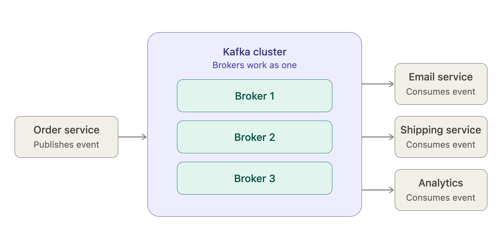
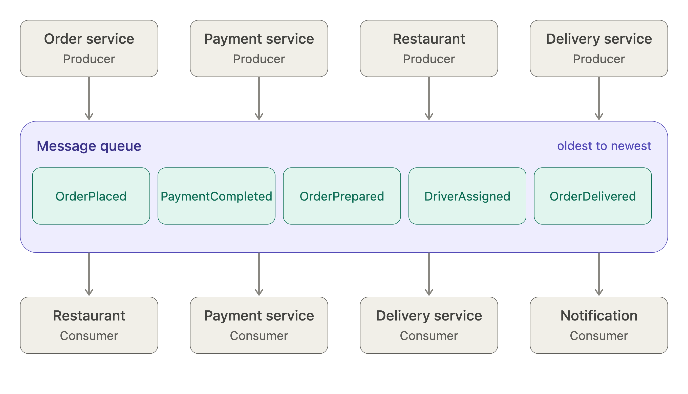
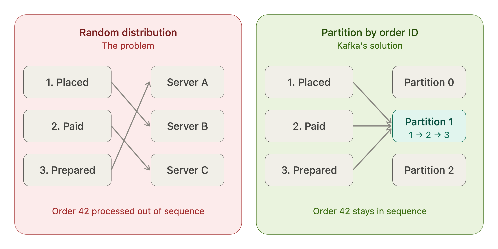
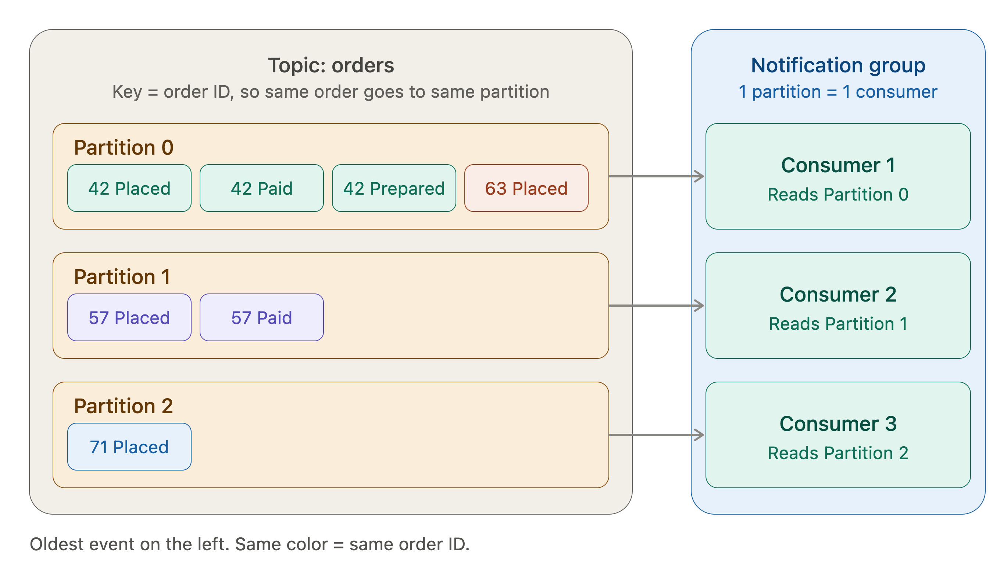
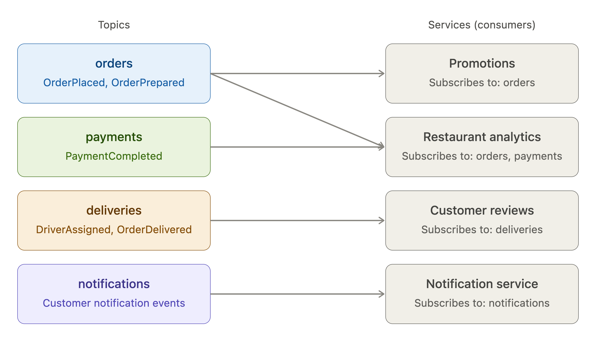

# Apache Kafka
## 1. Introduction
### What is Apache Kafka?
[Apache Kafka](https://kafka.apache.org/44/getting-started/introduction/) is an open-source, distributed event streaming platform used to collect, store, and process streams of events in real time.
#### 1. What is an event?
    An event is a record of something that happened in a system.

    For example, in an e-commerce application:
    - A customer placed an order.
    - A payment was completed.
    - A user registered.
    - A product was shipped.

    Each of these is an event.

    An event describes something that has already happened.
#### 2. What does event streaming mean?
    Event streaming means continuously capturing, storing, and processing events as they happen.

    For example:
    1. A customer places an order.
    2. The application generates an OrderCreated event.
    3. The event is sent to Kafka.
    4. Other services can consume and process it.

#### 3. What does distributed mean?
    Kafka can run across multiple servers called brokers, working together as one cluster.

    This helps Kafka handle large amounts of data, scale, and tolerate server failures.

*Figure 1: How Kafka enables communication between services through events.*

## Motivation Example:
Imagine we are building a food delivery platform like Uber Eats. Every time a customer places an order, several things happen:
1. The restaurant receives the order.
2. The payment service processes the payment.
3. The delivery service looks for an available driver.
4. The notification service sends updates to the customer.

Each of these actions generates an event. For example:
1. OrderPlaced
2. PaymentCompleted
3. OrderPrepared
4. DriverAssigned
5. OrderDelivered

We need a way to communicate these events to different services without making the services depend directly on each other.

One solution is to use a message queue. The application responsible for publishing events is called the **producer**, while the applications that receive and process these events are called **consumers**.

### What happens when the platform grows?
    Now imagine our platform becomes extremely popular. Instead of hundreds of orders, we receive hundreds of thousands of orders every minute.

A single server handling all these events may no longer be able to keep up. We need to distribute the workload across multiple servers.

However, we have another problem: event ordering.

Consider one particular order:
1. OrderPlaced
2. PaymentCompleted
3. OrderPrepared
4. DriverAssigned
5. OrderDelivered

 **These events must be processed in the correct order. We cannot deliver an order before it has even been placed!**

### 🔀 How Do We Preserve Event Ordering?
#### ⚠️ The Problem
**Randomly distributing events** across different servers could cause events belonging to the same order to be processed **out of sequence**.

Kafka addresses this using <strong>partitions</strong>.

This ensures that events belonging to the same order are sent to the
<strong>same partition</strong>,
preserving their <strong>order</strong> within that partition.

  

  <em>
    Figure: Random distribution sends events from the same order to different servers,
    potentially causing out-of-order processing. Partitioning by orderId routes
    them to the same partition, preserving their order.
  </em>

### What if consumers become overwhelmed?
Even after distributing events across partitions, consumers may struggle to process the <strong>growing number of messages</strong>.

We can add more consumers and organize them into a <strong>consumer group</strong>.

Kafka distributes <strong>partitions</strong> among the consumers in the group. Each partition is assigned to <strong>only one consumer</strong> in that group at a time.

This allows multiple consumers to process different partitions in <strong>parallel</strong>, increasing <strong>processing capacity</strong>.

  

  <em>
    Figure: Events are distributed across partitions based on orderId.
    Each color represents a different order, and all events belonging to
    the same order remain in the same partition and in sequence.
  </em>

**Partition distribution:**

- 🔵 **Partition 0:** Order 42 (all three events) and Order 63.
- 🟢 **Partition 1:** Order 57.
- 🟠 **Partition 2:** Order 71 (added to give Consumer 3 a partition to process).

**Consumer assignment:** Each consumer reads from one partition, allowing consumers to process different partitions in parallel while preserving event ordering within each partition.

### What If We Have Different Types of Events?

As our platform grows, we might introduce additional services, such as **customer reviews**, **promotions**, and **restaurant analytics**.

Not every service needs every event.

Kafka organizes events into <strong>topics</strong>. For example:

- 🔵 <strong>`orders`</strong>: Order creation and status updates.
- 🟢 <strong>`payments`</strong>: Payment processing events.
- 🟠 <strong>`deliveries`</strong>: Driver assignment and delivery updates.
- 🟣 <strong>`notifications`</strong>: Events used to send customer notifications.

Consumers can <strong>subscribe</strong> to the topics relevant to their responsibilities.

This allows different services to <strong>consume events independently</strong> without receiving messages they do not need.

  

  <em>
    Figure: Kafka topics and their subscribing services.
    Each topic contains specific event types, and services subscribe only
    to the topics relevant to their responsibilities.
    Restaurant Analytics subscribes to both <strong>orders</strong> and
    <strong>payments</strong>, while each of the other services subscribes
    to a single topic.
  </em>

### What is Kafka?

### What problem does it solve?

### Why do we need it?

## 2. Architecture

### Kafka Cluster

### Brokers

### Topics

### Partitions

## 3. How Kafka Works

## 4. Advantages and Disadvantages

## 5. Real-world Use Cases

## 6. Practical Examples

## 7. References